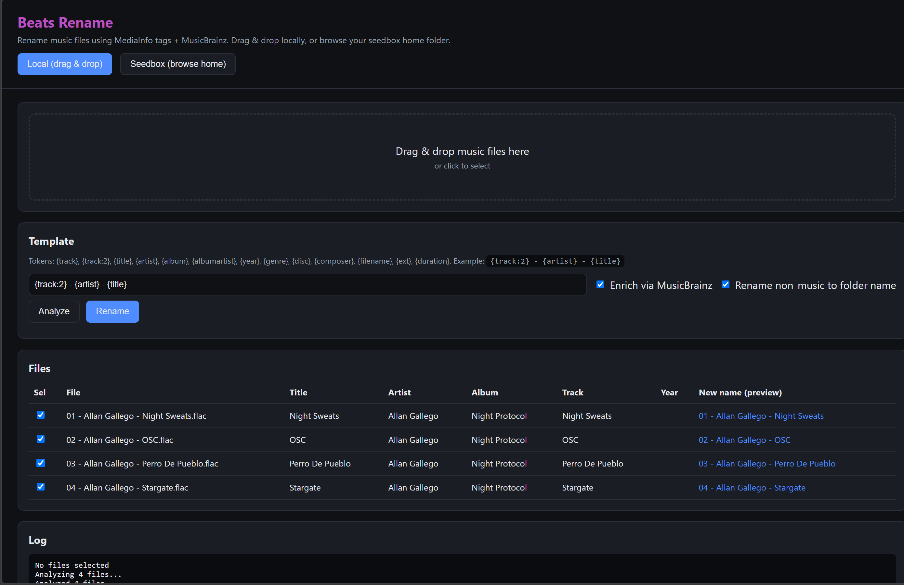
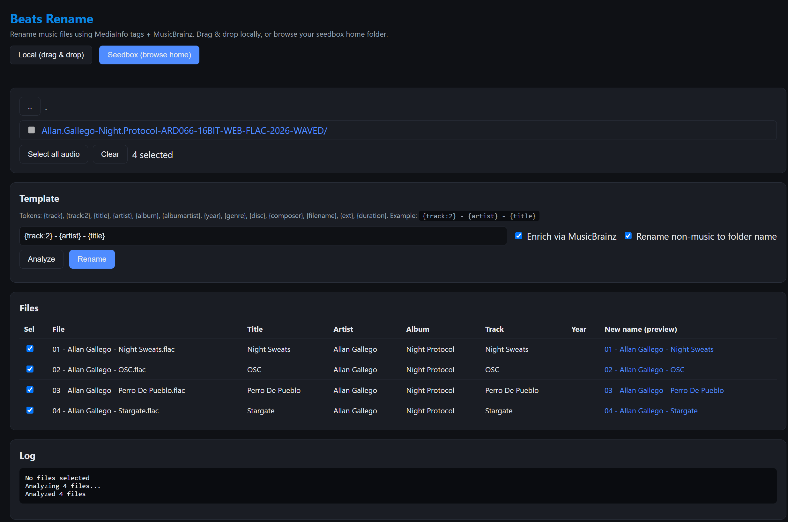
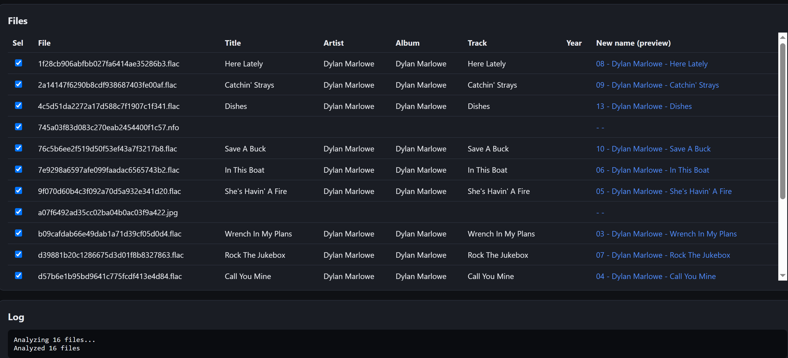

# Beats Rename — WebUI Music File Renamer

[](LICENSE)
[](https://nodejs.org)
[](https://github.com/wildfirebill-arrrs/beats-rename)

> Rename music files from messy hashes to clean, tagged names — using **MediaInfo** for metadata and **MusicBrainz** for canonical track info. Runs as a self-hosted Node.js web app, perfect for **seedboxes (Ultra.cc)** and local use.

## Table of Contents

- [Features](#features)
- [Screenshots](#screenshots)
- [Quick Start](#quick-start)
- [Rename Template Tokens](#rename-template-tokens)
- [Seedbox Installation (Ultra.cc)](#seedbox-installation-ultracc)
- [Environment Variables](#environment-variables)
- [Authentication](#authentication)
- [Security](#security)
- [FAQ](#faq)
- [License](#license)

## Features

- **Drag & drop** local audio files — upload, analyze, rename, download as ZIP
- **Seedbox mode** — browse your home folder, select audio + non-music files
- **MediaInfo tag extraction** — title, artist, album, track number, year, genre, disc
- **MusicBrainz enrichment** — canonical recording match with studio-album preference
- **Flexible rename templates** with zero-padding (`{track:2}`)
- **Track title translation** (Google Translate + MyMemory fallback) to 12 languages
- **Non-music files** (covers, .nfo, .m3u) renamed to the folder name
- **Password-protected WebUI** — cookie sessions, rate-limited login
- **Path-traversal-safe** browsing restricted to `ROOT_DIR`
- Works on **Ultra.cc seedbox** via unofficial Node.js installer

## Screenshots

### Desktop WebUI


### Seedbox Home-Folder Browser


### Seedbox Running


## Quick Start

```bash
git clone https://github.com/wildfirebill-arrrs/beats-rename.git
cd beats-rename
npm install
npm start
# open http://localhost:3000
```

On first run a random password is printed to the console and saved to `.auth`.

## Rename Template Tokens

| Token | Description |
|---|---|
| `{track}` / `{track:2}` | Track number (zero-padded with `:N`) |
| `{title}` | Track title |
| `{artist}` | Artist / performer |
| `{album}` | Album name |
| `{albumartist}` | Album artist |
| `{year}` | Year / recorded date |
| `{genre}` | Genre |
| `{disc}` | Disc number |
| `{composer}` | Composer |
| `{filename}` | Original filename |
| `{ext}` | File extension |
| `{duration}` | Duration |
| `{folder}` | Parent folder name |

Example template: `{track:2} - {artist} - {title}` → `04 - Allan Gallego - Stargate.flac`

## Seedbox Installation (Ultra.cc)

1. Install Node.js via the [unofficial language installer](https://docs.ultra.cc/unofficial-language-installers/install-nodejs).
2. Ensure `mediainfo` is on PATH (`mediainfo --version`).
3. Clone the repo into your slot:
   ```bash
   mkdir -p ~/apps && cd ~/apps
   git clone https://github.com/wildfirebill-arrrs/beats-rename.git
   cd beats-rename
   ```
4. `npm install --omit=dev`
5. Run: `PORT=3000 ROOT_DIR=$HOME node server.js` (or use pm2/screen).
6. Access via your slot's reverse proxy / port.

### Update to latest version
```bash
cd ~/apps/beats-rename
git pull
npm install --omit=dev
# restart the app
```

### Run as a service (screen)
```bash
screen -S beats -dm bash -c 'cd ~/apps/beats-rename && PORT=3000 ROOT_DIR=$HOME node server.js'
```

## Environment Variables

| Variable | Default | Description |
|---|---|---|
| `PORT` | `3000` | HTTP port |
| `ROOT_DIR` | `$HOME` | Root for seedbox browsing |
| `MAX_UPLOAD_MB` | `200` | Max upload size |
| `AUTH_USER` | `admin` | Login username |
| `AUTH_PASS` | auto-generated | Login password |
| `AUTH_SECRET` | auto-generated | Session cookie signing secret |
| `FORCE_SECURE` | unset | Set `1` for HTTPS behind a reverse proxy |
| `TRANSLATE_URL` | unset | Custom LibreTranslate endpoint (if public providers are blocked) |

## Authentication

All `/api/*` routes require login. On first run without `AUTH_PASS`, a random password is generated, printed to the console, and saved to `.auth` (mode 0600). Sessions are httpOnly, `SameSite=Strict` cookies with 7-day expiry; login is rate-limited (8 attempts/min/IP).

For production, set `AUTH_USER` and `AUTH_PASS` env vars.

## Security

- Browsing restricted to `ROOT_DIR` (path traversal blocked).
- Uploads stored in OS temp dir per session.
- MusicBrainz requests include a User-Agent per their policy.
- Never commit `.auth` / `.secret` (gitignored).

## FAQ

**Q: Does it rename files in place on the seedbox?**
A: Yes. Consider backing up first.

**Q: Can it identify tracks without tags?**
A: MusicBrainz lookup uses metadata/filename search. AcoustID fingerprinting (requires fpcalc) is not included.

**Q: Which audio formats are supported?**
A: mp3, flac, m4a, aac, ogg, opus, wav, wma, ape, aiff, alac, dsf, and more.

## License

MIT — see [LICENSE](LICENSE).

## AI Assistance Disclosure

This project was developed with assistance from an AI coding agent (Claude). All code was reviewed and tested by the maintainer. AI was used for scaffolding, debugging, and documentation generation.